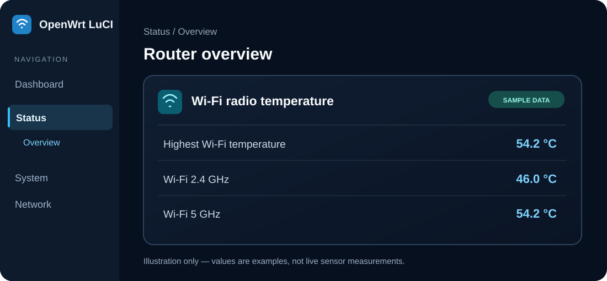

# دمای Wi-Fi در LuCI | luci-app-wifi-temperature

[](https://github.com/ClassicDarkPack/luci-app-wifi-temperature/actions/workflows/build-packages.yml)
[](LICENSE)

**[English README](README.md) | راهنمای فارسی**

ابزاری سبک برای نمایش **دمای چیپ‌های وای‌فای** در صفحهٔ **Status → Overview** پنل LuCI در OpenWrt. این پروژه در اصل برای **Google WiFi Gale (IPQ4019)** طراحی شده است و دما را از سنسورهای `ath10k_hwmon` (و در صورت وجود `ath11k_hwmon`) می‌خواند.



> **تصویر بالا طرح نمایشی است، نه اسکرین‌شات واقعی روتر.** اعداد آن نمونه‌اند و روی هر دستگاه با توجه به سنسورها فرق می‌کنند.

## چه چیزهایی نمایش داده می‌شود؟

| عنوان | معنی |
| --- | --- |
| **Highest Wi-Fi temperature** | بیشترین دمای معتبر بین سنسورهای وای‌فای؛ **دمای CPU نیست** |
| **Wi-Fi 2.4 GHz** | دمای رادیوی متناظر با `a000000.wifi` در سخت‌افزار هدف |
| **Wi-Fi 5 GHz** | دمای رادیوی متناظر با `a800000.wifi` در سخت‌افزار هدف |

اگر سنسور پیدا نشود یا مسیر آن قابل تشخیص نباشد، به جای عدد نادرست پیام **Not available** نمایش داده می‌شود.

## 📥 دانلود فایل نصب

**[رفتن به Releases](https://github.com/ClassicDarkPack/luci-app-wifi-temperature/releases/latest)** | **[گرفتن خروجی ساخت موفق از Actions](https://github.com/ClassicDarkPack/luci-app-wifi-temperature/actions/runs/43191675491)**

| نسخهٔ OpenWrt که در CI ساخته شده | دانلود مستقیم نسخهٔ v1.1.0 | ابزار نصب |
| --- | --- | --- |
| **23.05.6** | **[دانلود فایل IPK](https://github.com/ClassicDarkPack/luci-app-wifi-temperature/releases/download/v1.1.0/wifi-temperature-openwrt-23.05.6-ipk__luci-app-wifi-temperature_1.1.0_all.ipk)** | `opkg` |
| **24.10.4** | **[دانلود فایل IPK](https://github.com/ClassicDarkPack/luci-app-wifi-temperature/releases/download/v1.1.0/wifi-temperature-openwrt-24.10.4-ipk__luci-app-wifi-temperature_1.1.0-r1_all.ipk)** | `opkg` |
| **25.12.6** | **[دانلود فایل APK](https://github.com/ClassicDarkPack/luci-app-wifi-temperature/releases/download/v1.1.0/wifi-temperature-openwrt-25.12.6-apk__luci-app-wifi-temperature-1.1.0-r1.apk)** | `apk` |

**[بررسی صحت فایل‌ها (SHA256SUMS)](https://github.com/ClassicDarkPack/luci-app-wifi-temperature/releases/download/v1.1.0/SHA256SUMS)** · برای نسخه‌های بعدی صفحهٔ [آخرین Release](https://github.com/ClassicDarkPack/luci-app-wifi-temperature/releases/latest) را ببین.

این پکیج از نوع `all` ساخته می‌شود، اما **تشخیص دقیق رادیوها وابسته به سخت‌افزار** است. روی نسخه‌های دیگر OpenWrt یا روترهای دیگر، عملکرد سنسورها هنوز تأیید نشده است.

**اگر صفحهٔ Releases فایل نصبی ندارد:** در لینک Actions بالا به بخش **Artifacts** برو؛ فایل متناسب با نسخهٔ روتر را دانلود و **ZIP آن را روی کامپیوتر استخراج کن**. فایل `.ipk` یا `.apk` داخل ZIP را لازم داریم، نه خود ZIP. برای دانلود Artifacts ممکن است نیاز باشد وارد حساب GitHub شوی.

## 🚀 نصب در چند مرحله

### مرحلهٔ ۱: نسخهٔ روتر را مشخص کن

با SSH به روتر متصل شو و اجرا کن:

```sh
cat /etc/openwrt_release
```

مقدار `DISTRIB_RELEASE` را بخوان تا فایل درست را انتخاب کنی.

### مرحلهٔ ۲: فایل را به روتر منتقل کن

فایل `.ipk` یا `.apk` دانلودشده را با **WinSCP / SFTP** یا دستور `scp` در مسیر `/tmp/` روتر کپی کن.

نمونه دستور روی کامپیوتر (IP را با آدرس واقعی روتر جایگزین کن):

```sh
scp ./YOUR_DOWNLOADED_PACKAGE.ipk root@192.168.1.1:/tmp/
```

برای نسخهٔ جدید، به جای `.ipk` فایل `.apk` را بفرست.

### مرحلهٔ ۳: نصب را انجام بده

**برای OpenWrt 23.05 و 24.10:**

```sh
opkg update
opkg install /tmp/*luci-app-wifi-temperature*.ipk
```

**برای OpenWrt 25.12:**

```sh
apk update
apk add --allow-untrusted /tmp/*luci-app-wifi-temperature*.apk
```

> مهم: قبل از اجرای دستور، فقط **یک فایل نصب مطابق الگو** در `/tmp/` داشته باش. `apk` با `opkg` فرق دارد و پسوند APK در OpenWrt **به معنی اپ اندروید نیست**. گزینهٔ `--allow-untrusted` برای نصب بستهٔ APK محلی بدون امضای مخزن استفاده می‌شود؛ فقط فایل مورداعتماد را نصب کن.

### مرحلهٔ ۴: نمایش دما را ببین

وارد رابط وب روتر شو و مسیر زیر را باز کن:

**Status → Overview → Wi-Fi radio temperature**

اگر ویجت را ندیدی، در SSH این دستور را اجرا کن و صفحه را با بارگذاری مجدد اجباری (Hard Refresh) باز کن:

```sh
/etc/init.d/rpcd restart
```

معمولاً نیازی به ریبوت نیست.

## 🔎 اگر دما نمایش داده نشد

برای بررسی مستقیم سنسورها:

```sh
/usr/libexec/luci-wifi-temperature

for name in /sys/class/hwmon/hwmon*/name; do
    [ -f "$name" ] && printf '%s: ' "$name" && cat "$name"
done
```

خروجی نمونه:

```json
{"device":54200,"radio24":46000,"radio5":54200}
```

اعداد برحسب **هزارم درجهٔ سانتی‌گراد** هستند؛ یعنی `54200` برابر `54.2 °C` است. این خروجی **فقط مثال** است. مقدار `null` یعنی سنسور شناسایی نشده است.

برای بررسی مسیر دستگاه‌های وای‌فای:

```sh
for hw in /sys/class/hwmon/hwmon*; do
    [ -e "$hw/device" ] && echo "$hw: $(readlink -f "$hw/device")"
done
```

اگر مسیر رادیوهای دستگاهت با `a000000.wifi` و `a800000.wifi` فرق دارد، ممکن است دما در ردیف 2.4 یا 5 گیگاهرتز نمایش داده نشود. **نباید این مقادیر را به جای دمای CPU تعبیر کرد.**

اگر خطای دسترسی داشتی:

```sh
/etc/init.d/rpcd restart
logread -e rpcd
```

اگر نصب به خاطر وابستگی‌ها شکست خورد، اتصال اینترنت و مخازن متناسب با نسخهٔ فریمور را بررسی کن.

## 🗑️ حذف برنامه

برای نسخه‌های قدیمی با IPK:

```sh
opkg remove luci-app-wifi-temperature
```

برای نسخهٔ جدید با APK:

```sh
apk del luci-app-wifi-temperature
```

## 🛠️ اطلاعات فنی و ساخت

- مسیر ویجت: `htdocs/luci-static/resources/view/status/include/15_wifi_temperature.js`
- اسکریپت خواندن دما: `/usr/libexec/luci-wifi-temperature`
- دسترسی خواندن از طریق ACL مخصوص `rpcd` محدود شده است.
- Workflow ساخت خودکار: [Build OpenWrt packages](.github/workflows/build-packages.yml)
- خروجی‌ها با **SDK رسمی OpenWrt** ساخته می‌شوند؛ موفقیت ساخت به معنای تست واقعی سخت‌افزار نیست.
- برای روش ساخت دستی با SDK، [README انگلیسی](README.md) را بخوان.

### منابع الهام و مطالعه

- [gSpotx2f/luci-app-temp-status](https://github.com/gSpotx2f/luci-app-temp-status)
- [kevindoni/temperatur-luci](https://github.com/kevindoni/temperatur-luci)
- [مدیریت بسته‌ها در OpenWrt](https://openwrt.org/docs/guide-user/additional-software/managing_packages)

اگر مشکلی پیدا کردی، از طریق [Issues](https://github.com/ClassicDarkPack/luci-app-wifi-temperature/issues) همراه با نسخهٔ OpenWrt و مسیر سنسورها گزارش بده (بدون اطلاعات محرمانه).

**مجوز انتشار:** [MIT](LICENSE).
