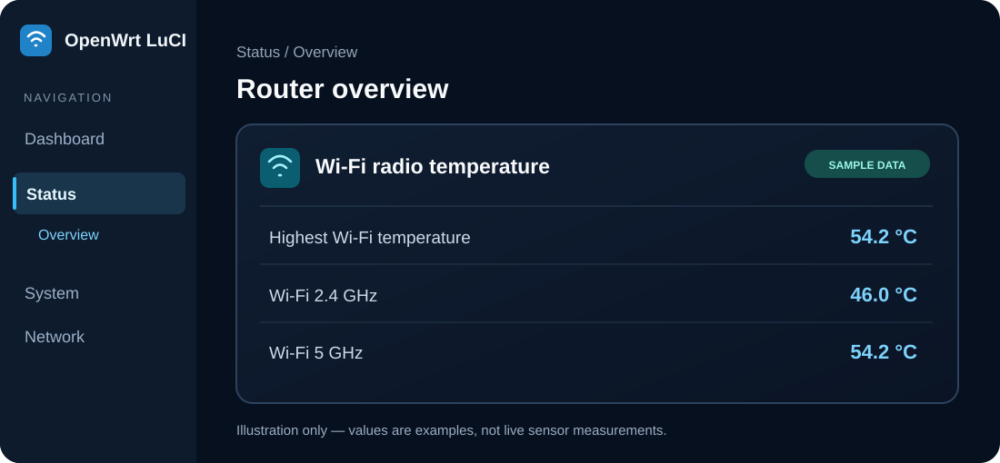

# LuCI Wi-Fi Temperature

[](https://github.com/ClassicDarkPack/luci-app-wifi-temperature/actions/workflows/build-packages.yml)
[](LICENSE)
[](#supported-openwrt-versions)

**English** · [فارسی — راهنمای نصب و استفاده](README.fa.md)

A lightweight, read-only **Wi-Fi radio temperature** widget for **LuCI → Status → Overview**. Designed primarily for **Google WiFi Gale (IPQ4019)**, using `ath10k_hwmon` sensors exposed by the OpenWrt kernel.

No background daemon, no configuration page, and no invented temperature values.



> **Illustrative preview, not a router screenshot.** Numbers above are examples. Actual temperatures depend on the device, kernel driver and available sensors.

## ✨ What it displays

| LuCI label | Meaning |
| --- | --- |
| **Highest Wi-Fi temperature** | Highest valid reading from compatible Wi-Fi radio sensors; **not the CPU/SoC temperature** |
| **Wi-Fi 2.4 GHz** | The radio mapped to `a000000.wifi` on the intended Gale hardware |
| **Wi-Fi 5 GHz** | The radio mapped to `a800000.wifi` on the intended Gale hardware |

Temperature is displayed in **°C**, to one decimal place. If a sensor is missing or cannot be identified, its row displays **Not available** instead of guessing.

## 📦 Quick installation

### 1. Check your OpenWrt version

Connect to the router over SSH and run:

```sh
cat /etc/openwrt_release
```

Find `DISTRIB_RELEASE`, then choose a matching package:

### Supported OpenWrt versions

| OpenWrt build tested in CI | File to download | Package manager |
| --- | --- | --- |
| **23.05.6** | `.ipk` | `opkg` |
| **24.10.4** | `.ipk` | `opkg` |
| **25.12.6** | `.apk` | `apk` |

The package contains only scripts and LuCI resources, so it is built with architecture `all`. **The radio hardware mapping is Gale-specific**; an architecture-independent file does not guarantee sensor support on every router. Other patch releases have not been individually verified here.

### 2. Download the installable file

**[📥 GitHub Releases](https://github.com/ClassicDarkPack/luci-app-wifi-temperature/releases/latest)** · **[✅ Successful build artifacts](https://github.com/ClassicDarkPack/luci-app-wifi-temperature/actions/runs/43191675491)**

- **Preferred:** Open **Releases → Assets** and select the `.ipk` or `.apk` for your firmware.
- **If the Release has no attached packages:** open the successful Actions run, go to **Artifacts**, download the archive named `wifi-temperature-openwrt-<version>-<format>`, and **extract the ZIP** on your computer. Use the `.ipk` / `.apk` file **inside**, not the ZIP itself.
- Package filenames may be prefixed with the OpenWrt version. Match the **extension and version**, not just the filename.

### 3. Copy the file to the router

Using SCP on your computer (replace the filename and router IP as needed):

```sh
scp ./YOUR_DOWNLOADED_PACKAGE.ipk root@192.168.1.1:/tmp/
```

For OpenWrt 25.12, replace `.ipk` with `.apk`. You can also use any SFTP client to upload the file into `/tmp/`.

### 4. Install over SSH

**OpenWrt 23.05 / 24.10 — IPK (`opkg`):**

```sh
opkg update
opkg install /tmp/*luci-app-wifi-temperature*.ipk
```

**OpenWrt 25.12 — APK (`apk`):**

```sh
apk update
apk add --allow-untrusted /tmp/*luci-app-wifi-temperature*.apk
```

> Keep **only one matching package** in `/tmp` before using these wildcard commands. `--allow-untrusted` is needed for a locally built/unsigned APK; only install packages you trust. Never install an APK with `opkg` or an IPK with `apk`.

### 5. Open the widget

Run `/etc/init.d/rpcd restart` if the widget does not appear immediately, then **hard-refresh your browser** and navigate to:

**LuCI → Status → Overview → Wi-Fi radio temperature**

No router reboot should be required.

## 🩺 Troubleshooting

**Widget appears, but says “Not available”?** Check which sensors your kernel exposes:

```sh
/usr/libexec/luci-wifi-temperature

for name in /sys/class/hwmon/hwmon*/name; do
    [ -f "$name" ] && printf '%s: ' "$name" && cat "$name"
done
```

An example helper result is:

```json
{"device":54200,"radio24":46000,"radio5":54200}
```

Values are in **millidegrees Celsius** (e.g. `54200` means `54.2 °C`). `null` means a value is unavailable. The example above is **not** a real measurement.

**Radio labels look swapped or empty?** Verify your hardware paths:

```sh
for hw in /sys/class/hwmon/hwmon*; do
    [ -e "$hw/device" ] && echo "$hw: $(readlink -f "$hw/device")"
done
```

The `a000000.wifi` / `a800000.wifi` mapping applies to the project's original device target and may differ on other devices or kernels.

**Widget is missing or access is denied?**

```sh
/etc/init.d/rpcd restart
logread -e rpcd
```

Refresh LuCI. Also ensure `luci-base` and `luci-mod-status` are installed. If installation reports missing dependencies, confirm the router has internet access and that its package repositories match its firmware version.

## 🗑️ Uninstall

```sh
# OpenWrt 23.05 / 24.10
opkg remove luci-app-wifi-temperature

# OpenWrt 25.12
apk del luci-app-wifi-temperature
```

## 🛠️ Build from source

GitHub Actions uses the official OpenWrt SDK for `ipq40xx/generic` and builds all three package variants automatically. You can inspect the workflow at [`.github/workflows/build-packages.yml`](.github/workflows/build-packages.yml).

<details>
<summary><strong>Manual SDK build steps</strong></summary>

Clone the repository into a local feed with the standard LuCI package layout:

```sh
mkdir -p ~/wifitemp-feed/applications
git clone https://github.com/ClassicDarkPack/luci-app-wifi-temperature.git \
  ~/wifitemp-feed/applications/luci-app-wifi-temperature
cd /path/to/openwrt-sdk

[ -f feeds.conf ] || cp feeds.conf.default feeds.conf
printf '\nsrc-link wifitemp %s\n' "$HOME/wifitemp-feed" >> feeds.conf
./scripts/feeds update -a
./scripts/feeds install -p luci luci-base luci-mod-status
./scripts/feeds install -p wifitemp luci-app-wifi-temperature
make defconfig
echo 'CONFIG_PACKAGE_luci-app-wifi-temperature=m' >> .config
make defconfig
make package/feeds/wifitemp/luci-app-wifi-temperature/compile V=s
```

Find the resulting package under `bin/packages/`. Use an SDK matching your OpenWrt release. The upstream OpenWrt build scanner expects the conventional `call BuildPackage` marker in the package Makefile; do not remove it.

</details>

## ⚙️ Technical details and limitations

- Reads `/sys/class/hwmon/hwmon*/name` and `temp1_input` for `ath10k_hwmon` / `ath11k_hwmon` only.
- Checks numeric temperature ranges, returns structured JSON and never substitutes thermal-zone/CPU values as Wi-Fi readings.
- Uses a dedicated read-only shell helper at `/usr/libexec/luci-wifi-temperature` and a narrowly scoped rpcd ACL.
- **CI build success is verified** for the three versions listed above; **physical device installation and sensor accuracy are not yet confirmed**.

## 📚 References and credits

Useful related projects: [gSpotx2f/luci-app-temp-status](https://github.com/gSpotx2f/luci-app-temp-status) and [kevindoni/temperatur-luci](https://github.com/kevindoni/temperatur-luci). They provide general router temperature views; this project focuses on Wi-Fi radio temperature reporting for Gale.

Package management guidance: [OpenWrt Software Management](https://openwrt.org/docs/guide-user/additional-software/managing_packages) · [OpenWrt APK](https://openwrt.org/docs/guide-user/additional-software/apk).

Found a bug or have verified radio mappings for another device? [Open an issue](https://github.com/ClassicDarkPack/luci-app-wifi-temperature/issues) with your OpenWrt version and **non-sensitive** sensor paths.

**License:** [MIT](LICENSE).
